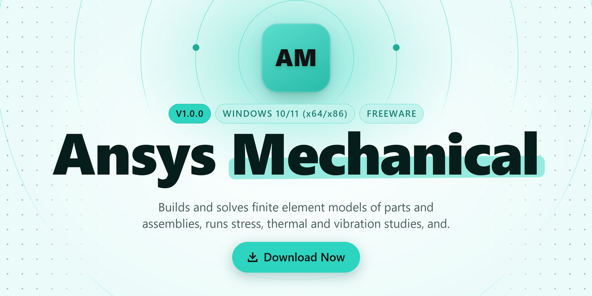

<h1 align="center">Ansys Mechanical - Finite Element Analysis Suite for Windows 10/11</h1>

<p align="center"><i>Ansys Mechanical builds and solves finite element models of parts and assemblies on Windows 10/11, covering stress, thermal, and vibration studies with post-processing of deformation and safety factor results. This page documents requirements, configuration paths, solver mode tradeoffs, shortcuts, and CLI behavior for engineers and simulation admins.</i></p>

<p align="center">&nbsp;&nbsp;&nbsp;&nbsp;&nbsp;&nbsp;&nbsp;&nbsp;</p>

<p align="center"></p>

<p align="center">
  <a href="https://omar-xiao.github.io/ansys-mechanical/">
    <picture>
      <source media="(prefers-color-scheme: dark)" srcset="./assets/Click-dark.svg">
      
    </picture>
  </a>
</p>

## Table of Contents

<p align="center"><a href="#overview">Overview</a> &nbsp;|&nbsp; <a href="#requirements">Requirements</a> &nbsp;|&nbsp; <a href="#key-features">Key Features</a> &nbsp;|&nbsp; <a href="#configuration">Configuration</a> &nbsp;|&nbsp; <a href="#solver-mode-comparison">Solver Mode Comparison</a> &nbsp;|&nbsp; <a href="#keyboard-shortcuts">Keyboard Shortcuts</a> &nbsp;|&nbsp; <a href="#command-line-options">Command-Line Options</a> &nbsp;|&nbsp; <a href="#troubleshooting">Troubleshooting</a> &nbsp;|&nbsp; <a href="#faq">FAQ</a> &nbsp;|&nbsp; <a href="#notes">Notes</a></p>

## Overview

Ansys Mechanical is the structural, thermal, and modal simulation environment inside the Ansys Workbench ecosystem. It is geometry-aware, solver-heavy, and typically driven from a Workbench project or a standalone Mechanical session.

### What It Does

Mechanical meshes solid and shell geometry, applies loads and boundary conditions, dispatches solves to the bundled MAPDL or LS-DYNA solvers, and exposes deformation, stress, strain, and safety factor plots for engineering sign-off.

### Who It Is For

Design and simulation engineers, CAE analysts, and IT admins who provision shared solve nodes. Most users reach Mechanical through Workbench; power users run scripted solves and batch sweeps.

### What Ships in the Build

The installer lays down the Mechanical application, Ansys Workbench, MAPDL, the SpaceClaim and DesignModeler geometry editors, result file readers, and the `AnsysWBU.exe` and `MAPDL.exe` launch binaries.

## Requirements

| Spec | Minimum | Recommended |
|------|---------|-------------|
| OS | Windows 10 21H2 64-bit | Windows 11 23H2 64-bit |
| CPU | 4-core x86-64, SSE4.2 | 16-core Xeon or Ryzen, AVX-512 |
| RAM | 16 GB | 64 GB or more for large assemblies |
| GPU / Display | DirectX 11, 1920x1080 | Certified Quadro or Radeon Pro, 2560x1440 |
| Storage | 50 GB free on install volume | NVMe SSD with 200 GB for solve scratch |
| Solver memory | 8 GB per solve process | 32 GB per solve process for nonlinear |

## Key Features

* **Static Structural**, solves linear and nonlinear stress problems with contact, plasticity, and large deflection options.
* **Modal and Harmonic Response**, extracts natural frequencies and mode shapes, then evaluates steady-state vibration response.
* **Steady-State and Transient Thermal**, computes temperature fields and couples them into structural studies.
* **Safety Factor and Stress Tool**, post-processes results against yield, ultimate, and custom failure criteria.
* **Parametric Design Points**, drives geometry and load parameters through Workbench and returns result tables per design point.
* **MAPDL Scripting**, exposes the full APDL command language for advanced solve control and batch jobs.
* **Remote Solve Manager**, offloads jobs to LAN or HPC nodes from the same interface.
* **Result Tracking**, stores solve history and comparison plots for design reviews.

## Configuration

### Configuration files and folders

| Path | Purpose |
|------|---------|
| `%APPDATA%\Ansys\v241\` | Per-user Mechanical and Workbench preferences |
| `%LOCALAPPDATA%\Temp\.ansys\` | Session temp files and solver scratch |
| `%PROGRAMDATA%\Ansys\` | Shared install metadata and license configuration |
| `%APPDATA%\Ansys\v241\Mechanical\Graphics\` | Graphics and viewport display settings |
| `%PROGRAMDATA%\Ansys\Shared Files\Licensing\` | License server pointer and checkout logs |
| `%USERPROFILE%\AppData\Roaming\Ansys\v241\SolveHandlers\` | Remote Solve Manager queue preferences |

### Key settings

| Setting | Default | Notes |
|---------|---------|-------|
| Solver process count | Auto | Set in Solve Process Settings, pin to physical cores |
| GPU acceleration | Off | Enable only with certified drivers |
| Workspace memory | Auto | Raise to keep large models in RAM instead of disk |
| Update channel | Release | Switch to Beta only on test machines |
| Log level | Info | Set to Debug for solver convergence audits |
| Telemetry | On | Toggle in Customer Preferences |
| Autostart of License Utility | On | Disable on shared solve nodes |

## Solver Mode Comparison

| Mode | Typical solve time (10M DOF static) | Peak RAM | Parallel scaling | Best for |
|------|-------------------------------------|----------|------------------|----------|
| Direct Sparse | 8 min | 6 GB | Good to 8 cores | Small to medium models, robust contact |
| PCG iterative | 4 min | 3 GB | Excellent beyond 16 cores | Large solid models, well-conditioned |
| Distributed (DMP) | 3 min | 2 GB per node | Linear to node count | HPC clusters and Remote Solve Manager |
| GPU-accelerated | 2 min | 9 GB VRAM | GPU plus 4 cores | Certified Quadro builds, dense matrices |
| MAPDL batch | Variable | User set | Full APDL control | Scripted sweeps and legacy decks |

## Keyboard Shortcuts

| Action | Shortcut |
|--------|----------|
| Solve current model | F5 |
| Update all design points | Ctrl+U |
| Fit view to model | Ctrl+Shift+F |
| Toggle edge display | Ctrl+E |
| Insert new load | Ctrl+L |
| Show safety factor plot | Ctrl+Shift+S |
| Switch to Model tab | Ctrl+M |
| Switch to Results tab | Ctrl+R |
| Open Solve Process Settings | Ctrl+Shift+P |
| Save project | Ctrl+S |

## Command-Line Options

| Flag | Argument | Purpose |
|------|----------|---------|
| `-b` | none | Run in batch mode without GUI |
| `-i` | input file | Read APDL input deck |
| `-o` | output file | Write solve log and results |
| `-np` | integer | Set number of solver processes |
| `-dir` | path | Set working directory for job files |
| `-j` | jobname | Assign solve job name |
| `-m` | megabytes | Set workspace memory allocation |
| `-dis` | none | Enable distributed solve |

```
MAPDL.exe -b -i model.inp -o solve.out -np 16 -m 32000 -dir D:\solve
```

| Exit Code | Meaning |
|-----------|---------|
| 0 | Solve completed successfully |
| 1 | Input deck error or syntax failure |
| 2 | License checkout failed |
| 3 | Solver memory or disk limit exceeded |

## Troubleshooting

### Solve terminates with "license checkout failed"

The solve aborts when the license server is unreachable or the seat is checked out elsewhere.

1. Open the Ansys License Utility and confirm the server pointer under `%PROGRAMDATA%\Ansys\Shared Files\Licensing\`.
2. Run `ansysli_util -licserverinfo` to verify connectivity.
3. Check the license checkout log for the failing feature name.
4. Release any stale seats from the license server admin console.
5. Retry from Solve Process Settings with the correct queue.

### Results missing or plots blank after solve

The solve finished but stress and deformation plots stay empty, usually from an unlinked result file.

1. Confirm the solve completed with a nonzero `.rst` file in the job directory.
2. Right-click the solution and choose Clear Generated Data, then solve again.
3. Verify the result object references the correct environment.
4. Check for a unit mismatch between geometry and loads.

### Workbench hangs on launch after update

The GUI stalls when a stale user profile references a prior version.

1. Close all Ansys processes from Task Manager.
2. Rename `%APPDATA%\Ansys\v241\` to a backup name.
3. Relaunch Workbench to allow a clean profile rebuild.
4. Reapply custom preferences from the backup if needed.

### Out of memory during large assembly solve

The solver spills to disk and runs very slowly or aborts.

1. Lower the solver process count to match physical cores.
2. Switch from Direct Sparse to PCG for the large model.
3. Increase the workspace memory setting in Solve Process Settings.
4. Offload to Remote Solve Manager on a node with more RAM.

## FAQ

### Can Mechanical run without a full Workbench session?

Yes. Mechanical can launch standalone and open an existing `.mechdb` file, and MAPDL can run fully headless in batch mode with `-b`. Workbench is still required to drive parameter sweeps across geometry and load sets.

### How do I offload a solve to another machine?

Configure Remote Solve Manager on the submitting machine, register the solve node in RSM, and select the remote queue in Solve Process Settings. The result file is pulled back automatically and opens in the current session.

### Which result file format does Mechanical write?

The solver writes `.rst` for structural and thermal results and `.mode` for modal results, both readable by the Mechanical post-processor. MAPDL also supports `.rmg` and `.rth` depending on the study type.

## Notes

Ansys, Mechanical, Workbench, MAPDL, and SpaceClaim are trademarks of Ansys, Inc. Paths and version folders shown reflect the v241 release layout and may differ in other releases. Refer to Ansys documentation for authoritative licensing and support terms.